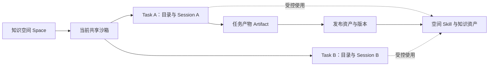

## 当前任务

11-06 当前先推进第一件“场景画像驱动的知识编译与反馈优化”。我此前提出需要两件专利，随后明确“第二篇先不要了吧”：知识表征方向暂缓，已有草稿保留，不再继续完善或作为当前提报事项。

两件讨论稿已按我的要求保存到飞书“知识编译”目录。飞书文档用于审阅，尚未完成正式专利提报。

版式按已交范文：开头三行提案表、表格内合规勾选、四列合并的必填项表；随后是“技术交底书正文”，六章及小节使用加粗段落。飞书版与本地稿均已对齐，未确认项保留待确认。

每人推进专利选题与材料。我在 11-04 补充：周一（11-02）同步时已经提出每个人要搞一个专利。

11-03 12:08，费夕杨在「知识编译研究院」进一步明确：本周每人贡献 **1–2 个专利**。[原消息](https://applink.feishu.cn/client/chat/open?openChatId=oc_15d5cdd538df73b4975ff96d38c7790a&position=11363)

群内通知 **11-06（周五）收口**。我的选题、认领与材料提交结果尚未确认。[认领与收口通知](https://applink.feishu.cn/client/chat/open?openChatId=oc_15d5cdd538df73b4975ff96d38c7790a&position=11387)

## 11-06 候选与认领情况

团队候选清单列出 **18 个候选点**；提报汇总已有 17 个新方向的初稿链接，P4 已并入 P3，P16 建议合并。P1 认领栏为车政行；P9、P13 标注李彦享有意认领，尚不能按最终认领处理。

其余多处认领栏为“张伟（初稿）”，对应智能体代拟；提报跟踪表的实际撰写人多仍待填写，两处字段并不等价。我的认领仍待确认。成熟度和效果为材料中的陈述，尚未逐项核实实现与评测证据。

| 编号 | 方向与具体机制 | 材料标注的阶段 / 认领线索 |
| --- | --- | --- |
| P1 | 统一元数据契约，治理并路由文件、Schema、图谱等不同资产 | 已上线；车政行 |
| P2 | 统一引用、多路召回，再按资产形态读取正文 | 已上线；实际撰写人待填写 |
| P3 / P4 | Token 预算分窗、模型配额调度、检查点续跑；大文档渐进探查与证据锚定并入 | 已上线、有实测；实际撰写人待填写 |
| P5 | 知识类型注册表约束“大类路由 → 类内抽取”的两阶段语义编译 | 已上线、有评测；实际撰写人待填写 |
| P6 | 确定性校验、跨源身份协调，同值合证据、异值保留冲突 | 已上线；实际撰写人待填写 |
| P7 | 来源内容指纹跳过未变材料，注册表变化使缓存失效，明确撤销与删除边界 | 已上线、有数据；实际撰写人待填写 |
| P8 | 基准评测、差距归因、优化与回归门禁 | 已落地运行；实际撰写人待填写 |
| P9 | Kernel/Harness 分离，Skill—CLI—算子分层，编译沙箱与持久存储衔接 | 已上线；李彦享有意认领 |
| P10 | 能力图冻结、局部解冻重组，验证后回沉能力库 | 方案阶段 |
| P11 | 规则与 Schema 解耦，绑定模型版本独立编译、模拟、发布和回滚 | 方案阶段 |
| P12 | 规则判断、函数计算、Playbook 编排三层分工及流程冲突处理 | 方案阶段 |
| P13 | Action 绑定对象、权限、前置条件和状态变化，按风险分级执行 | 方案阶段；李彦享有意认领 |
| P14 | 从业务结果差距形成候选知识，经评测、冲突检测和人审后发布 | 方案阶段 |
| P15 | 3D / BIM / GIS 等工程数据的投影索引与检索结果验证 | 点子 / 设计阶段 |
| P16 | 多阶段人审门禁与标识串联 | 已设计；建议并入 P1 / P3 |
| P17 | 外部声明式本体导入，保持约束语义并验证转换结果 | 需求 / 方案阶段 |
| P18 | 编译资产以协议、Skill、API 多出口发布，统一身份、版本和血缘 | 已上线；实际撰写人待填写 |

来源：11-06 读取[候选梳理](https://bytedance.larkoffice.com/wiki/OFPcwAEquilA6sk1DJ3cfhkxndR)（修订 3）及[提报汇总](https://bytedance.larkoffice.com/docx/CMXJdEWpOoh8IpxzELKc01phnpd)（修订 47）。两表的序号不同，讨论时统一用 P 编号。

## 当前选题主线：面向使用场景的知识编译（11-06）

**我的最新判断：** 核心价值在一整套知识编译方法论。第一点是基于使用场景编译合适的产物；空间面向具体使用用途组织，后续针对这些场景生成画像，让编译越来越精准。Agent、沙箱、会话和发布链路是这套方法的工程支撑。

**我这样判断的原因：** Agent 本身很难做出差异，Harness 也比较成熟，因此方法论更重要。这是我的技术与产品取舍；选题应优先解释场景理解、知识加工和产物适用性如何形成持续积累。

可按以下关系理解，后半段是后续方向：

> 使用场景与用途 → 知识空间 → 适合下游使用的编译产物 → 实际消费；后续形成场景画像，进一步指导编译。

空间除了权限、存储和执行边界，还承载“这些知识用来做什么”。选题先回答用途如何影响知识的加工与产物选择，再解释运行与治理机制如何支撑它。此前按提交提炼的三条工程亮点保留作实现依据，不再作为当前价值主线的排序。

**与 RAGFlow 的联系：** 我认为理念相似。此前[源码调研](/Users/bytedance/Projects/knowledge-compiler/docs/reports/2026-11-05-ragflow-knowledge-compilation.md)记录了模板驱动生成不同知识形态、供检索及 Agent 消费的机制。这里可作方法参照；本次尚未确认 RAGFlow 有同样的用途型空间与场景画像机制。

**AI 据此提出的技术化问题，待讨论：**

- 场景如何描述：需要完成的业务任务、使用知识的方式，以及对结果的要求，哪些能成为编译输入？
- 场景如何决定产物：怎样选择或组合 Wiki、本体、图谱、数据语义等形态，并约束字段、粒度、来源和消费接口？同一材料在不同用途下如何得到不同结果？
- 画像如何形成与生效：后续用哪些信息修正画像，画像的变化具体影响哪些编译配置或已有产物，怎样验证确实更适合用途？

上述字段、选择机制、反馈来源和评估方法尚未确定。场景画像与自动优化属于后续设想，不能按已实现闭环写交底。可暂以“面向使用场景的知识产物编译方法”为讨论题，先补具体输入、决策、输出和验证机制，再判断专利边界。

来源：2026-11-06 本专利选题会话中我的纠正与补充：“我们的核心价值不在于 agent 上，而在于一整套方法论”“基于场景编译合适的产物”“我们的空间就是面向这个使用用途”“后续我们会针对这些生成场景画像，然后越来越精准”。

## 第一件：场景驱动编译与画像演进合并（11-06）

**我的决定：** 将此前 AI 拆出的“场景驱动编译”和“消费反馈驱动画像演进”合成一件。二者共同描述场景编译方法的初次生产与持续调整。需要两件专利的目标保留，第二件另找独立问题。

**AI 暂拟题目：一种基于场景画像的知识产物编译与反馈优化方法。**

已按群内指定参照的技术交底书结构形成[完整讨论稿](专利交底书-场景画像驱动的知识编译与反馈优化.md)。包含合规自查、侵权可识别性及六章正文，补充画像到计划的映射、版本关联、反馈归因、定向再编译与基线验证；具体流程为 AI 辅助提出的实施方式，待我审阅。尚未确认整套设计、完成查新或提报。

拟议闭环：空间用途 → 初始场景画像 → 产物组合与编译配置 → 编译与消费 → 有依据的反馈归因 → 画像候选更新 → 受影响产物再编译与验证。画像如何表达、怎样改变编译决策，是需要补齐的核心机制。以下分为同一方案的两个阶段，具体步骤尚待确认。

### 阶段一：面向使用场景的知识产物选择与编译

技术问题：同一批材料在问答、关系查询、规则校验等不同用途下，需要不同的知识表示与消费接口；仅按文件类型处理，或人工选一个模板，难以说明如何匹配具体用途。

拟深化的机制，尚未全部形成方案：

1. 将空间用途表达为编译输入，明确任务类型、消费操作、结果所需粒度与约束。
2. 将候选产物的表达能力与上述需求匹配，形成产物组合、编译参数及执行依赖。
3. 执行编译，按用途所需的消费操作检查产物是否可用，保留来源及发布版本。

示例为 AI 说明用途的假设：同一份制度材料，问答用途可编译解释性页面与证据；合规校验用途可编译对象、条件与约束。具体选择策略和验证规则待明确。

已有工程依据：空间、不同类型产物、编译执行、来源与版本治理。尚需核对场景描述如何真正参与选择，不能把现有多产物支持直接写成自动场景规划已实现。与团队 P5 的类型注册表和类内抽取逐条划分，重点讨论“用途到产物组合”的机制。

### 阶段二：消费反馈驱动的场景画像更新与定向再编译

技术问题：初次定义的用途和知识表示可能与实际消费需求有偏差，需要判断偏差来自哪里，并明确后续应调整哪些编译决策。

拟深化的机制，属于 AI 提出的后续设计：

1. 将消费任务、结果和用户明确反馈关联到具体空间、产物版本及来源。
2. 区分材料缺失、编译遗漏、表达粒度或形态不适用等原因；证据不足时不直接更新画像。
3. 形成画像的候选变化，据此定位需要调整的产物类型、配置与已有内容；比较新旧结果后决定是否采用。

这一阶段围绕“画像如何变化、变化如何驱动编译”展开，与阶段一使用同一用途及产物关联关系，组成持续调整的方案。

**成熟度：** 场景画像是我明确提出的后续方向，上述反馈归因、影响定位与验证机制尚未确认，也未核实实现。合并选题不等于这些机制已实现；需补完整案例与可执行流程，不能仅用“越来越精准”代替技术方案。与 P8 的评测优化和 P14 的反馈形成候选知识重点核对，区别目前仅为拟议边界。

### 推进顺序

用同一材料、两个用途走通产物选择，再用一个真实消费偏差案例补齐“证据—画像变化—编译影响—验证”。优先讲清画像与编译策略的具体关联，运行机制作为支撑。

撰写参照：[国家知识产权局 2025 年《专利审查指南》修改解读](https://www.cnipa.gov.cn/art/2025/12/4/art_66_202935.html)要求场景应用说明算法与场景的结合、输入输出及关联，使方案可实现。这里仅核对公开撰写要求，未向外部检索提交内部候选方案。

来源：2026-11-06 本会话中我提出“需要出两个专利”，随后明确“合成一篇比较好”。合并为我的决定；题目、技术步骤为 AI 建议。

## 第二件：知识表征的结构、能力及转换（11-06）

**当前状态：暂缓。** 11-06 我明确“第二篇先不要了吧”。保留本地及飞书草稿，停止后续完善与推进。以下保留此前讨论。

**我此前的提议：** “知识应该有自己的表征形式怎么样的，各自解决什么的问题，要不围绕这个吧，第二个主题。”第二件当时据此转向知识表征，具体分类及技术机制尚未确认。

**AI 暂拟题目：一种基于表征契约的多形态知识编译与验证方法。** 已按群内交底书结构形成[第二件讨论稿](专利交底书-多形态知识表征的约束编译与验证.md)。

AI 建议按主要职责讨论命题与证据、解释性页面、概念语义模型、实体关系事实图、规则与约束、数据语义定义。类别可以交叉，不是互斥标准；重点是每类保留的含义、适用条件及支持的操作。不能把分类本身或更换存储格式当成已经确认的创新。

拟深化机制：明确表征的语义角色、必要字段、时间和例外等限定项、来源及操作前提；转换前检查目标是否能承载这些内容，转换后记录对应位置、增加的假设与遗漏项；通过验证后才开放相应的查询、求值或聚合能力。以上契约及转换流程为 AI 提出的实施方式，尚未确认完整设计或实现。

与第一件的边界：第一件研究使用场景如何选择、调整既有表征能力；第二件在用途和目标表示预先确定时，研究知识怎样被表达、转换及验证，不以场景画像或消费反馈优化为必要步骤。

通用概念核对：[OWL 2 Primer](https://www.w3.org/TR/owl2-primer/)区分类、属性、个体与公理；[RDF Concepts](https://www.w3.org/TR/rdf11-concepts/)描述图的三元组结构；[SHACL](https://www.w3.org/TR/shacl/)提供数据图约束校验。它们支持讨论语义结构和操作的区别，不证明本次候选具备新颖性。具体方案仍需与 P1、P5、P6、P17 及已交本体方案核对。

来源：2026-11-06 本会话中我的上述提议。主题来自我；题目、分类和实现步骤为 AI 建议。

### 早前候选 A：多形态知识产物的语义一致性编译与变更协调

**早前 AI 首选建议，现作表征主题的参考机制。** 同一业务知识可能同时出现在 Wiki、本体、图谱或规则中；独立生成、编辑和发布时，如何避免表达遗漏、语义分歧与版本错配？

拟深化的机制：为跨产物共享的业务概念与命题建立关联，保留适用条件、生效时间、例外和来源版本；在各产物中定位对应表达；变更时分析影响，分别重编译或标记待复核，并检查待发布产物的语义与依赖版本是否兼容。共享表达可以只覆盖交集，不预设所有知识必须经过统一图谱。

假设示例：审批额度从 10 万改为 20 万，同时存在“特殊项目仍为 10 万”的例外。Wiki、规则和图谱需要按同一条件表达，不能更新了 Wiki 就认为整组产物已经一致；不同生效时间或适用范围下的合法差异也不能误判为冲突。

与第一件的边界：第一件决定产物组合与策略；本件在产物组合和用途固定时，仍可研究跨表示的语义与变更一致性，不以画像学习为必要步骤。

已有基础是多类产物、来源快照、版本发布，以及图谱 / Wiki 各自的来源与贡献维护。上述跨形态命题映射、语义校验与协调发布尚未核实实现，不能归为我已完成的设计。仅加入共同 ID 或做版本校验不足以支撑完整方案。与 P1 的元数据治理、P6 的跨来源事实协调、P7 的增量处理逐条核对。

### 早前候选 B：保留适用条件与证据的知识编译及验证

技术问题：原文压缩成页面、事实或规则时，容易丢失适用对象、时间、例外与否定条件；附带原文链接也不能证明转换正确。

拟深化的机制：将候选知识与最小证据片段、适用条件及来源版本绑定；区分直接陈述、归纳和推导；检查条件遗漏、来源冲突与支持不足，对未通过项补证、回源或进入审阅。语义支持检查与引文定位分开，不能宣称引用有效即事实正确。

假设示例：原文说“A 类客户在试点期内可以免审”，产物不能简化成“客户可以免审”。需要指出哪一项条件在编译转换中丢失，如何定位和修复。

与第一件的边界：本件固定用途和输出类型，只研究转换过程中怎样保留知识含义并验证。已有来源治理可作基础；完整的条件保留与语义验证流程待设计。与 P3 / P4 的证据锚定、P6 的校验与冲突处理交集较大，先对齐边界。事实抽取与验证代码的本人贡献另行核对。

### 早前候选 C：业务知识到推理依据与可执行动作的两阶段编译

技术问题：从业务文档直接生成动作，可能跳过规则依据、约束检查和执行前提；怎样分阶段形成可检查的决策知识及可执行结果？

拟深化的机制：第一阶段把业务知识编译成对象、事实、规则与约束，形成决策及证据；第二阶段将决策绑定到目标系统动作及参数，检查执行时状态、权限和前置条件，再交目标系统执行并记录结果。需明确两阶段之间的契约、失败边界与重新决策条件。

假设示例：先根据试销规则判断商品能否进入某站，再把批准结果转成目标系统的申请或上架动作；决策通过与动作执行成功分别确认。

来源依据是我在 10-26 述职中的“两次编译”目标及 11-02 本体建设会议，见[本体建设](本体建设.md#10-26-述职中的方向判断)。这是方向依据，完整 Action 链路尚待建设。与 P11、P12、P13 高度相邻，独立题目和本人贡献需先对齐。

### 早前筛选判断

优先比较 A：它与第一件分别回答“知识怎样适合用途”和“同一知识的多个表示怎样协调”，也能利用我已有的空间、产物与版本治理积累。B 更聚焦可信知识加工，但团队已有选题交集较多；C 与我的长期目标一致，当前待建设部分和协作依赖更多。

普通来源变更驱动增量重编译与 P7 及此前 RAGFlow 调研直接相邻，暂不另列优先题。上述三个方向都需要具体机制、例子与对照；不是更换标题即可判定为独立创新。

公开基础对照：[W3C PROV-O](https://www.w3.org/TR/prov-o/)已有来源、派生及失效的表达，[SHACL](https://www.w3.org/TR/shacl/)已有数据图约束校验。仅引入血缘或通用校验不能作为本次方案的差异依据；本轮只核对通用公开基础，未做候选方案的新颖性检索，未将内部方案提交外部搜索。

来源：2026-11-06 本会话中我要求“还有哪些方向可以选，最好也是围绕知识编译的方法论”。以上是当时的 AI 候选及排序，后续已按我的最新提议转向知识表征主题。

## 我明确的核心积累（11-06）

我的原话：“我觉得我最核心的是 agent、知识空间（沙箱）、共享和隔离会话，这块的编译设计。”

这部分是我的实际工程积累；选题价值主线以本页开头最新判断为准，具体实现、已有设计与后续设想继续区分。尚未确认认领某件专利。

**早前 AI 据此提出的工程方向：** 从 P9 相关内容中聚焦知识编译的空间共享、会话隔离与执行状态组织，暂拟题目“一种面向知识编译的知识空间共享与会话隔离执行方法”。当前选题以我后来明确的场景编译方法论为主，这部分保留作工程积累与支撑机制。

11-06 开始讨论时提出的待核对问题，代码核对结果见下文：

- 知识空间、Agent、会话、沙箱如何对应；共享会话与隔离会话分别共享和隔离哪些状态。
- Agent 开始编译时获得哪些文件、上下文与能力，读写范围由什么机制决定。
- 不同会话的中间产物如何处理，什么条件下才能供其他会话使用。
- 会话结束、沙箱回收或任务恢复时，哪些状态保留、如何恢复。这里只列待讨论问题，未认定已有这些机制。

与现有 P9 的沙箱生命周期同步、已交 VFS 记忆管理存在交集，后续按具体技术方案比较。此前 Agent Infra 方案中的“Runtime 与 KC 共用 / 独立沙箱”讨论的是执行实例关系，不能直接替代本次会话共享与隔离的定义。

来源：2026-11-06 本专利选题会话中我的明确补充。

## 述职补充的贡献依据（11-06）

[10-26 述职材料](https://bytedance.larkoffice.com/docx/DlN6dDHOroHoq3xenidc9D5DnAh)说明，我负责知识编译整体架构与技术落地，实际积累覆盖从原型到标品、SaaS 适配及通用 Agent 协同。选题依据扩展到已有的编译执行体系设计。

| 已有贡献依据 | 可继续深挖的技术机制 |
| --- | --- |
| Agent 定义与执行分离，通过提示词、工具、Skill、Hook 声明能力，复用执行链路 | Agent 定义如何被装配到指定空间和会话，其能力与状态如何绑定 |
| 会话加载、流式执行、上下文压缩、消息及结果持久化 | 持续编译中的上下文与执行状态如何衔接，恢复时如何保持一致 |
| 工作区文件与业务产物衔接，中间产物持久化、登记、卡片展示及发布 | 工作区中的候选文件如何转换为工程系统可管理的编译产物，何时进入共享资产范围 |
| VFS、图存储、沙箱的私有化 / SaaS 适配 | 不同执行环境下如何保持同一套编译与产物管理语义 |

述职架构图明确了会话生命周期 Hook、隔离 Workspace、文件变化记录及应用层产物登记。空间共享、Task 目录和会话上下文的实际边界，已在下文按代码核对。

**早前 AI 的收敛建议：** 围绕 Agent 在空间中组织会话与工作区、持续编译及产物治理抽取方案。根据我后来的纠正，这些作为场景编译的工程支撑；P9 可作对照，不预设其全部技术点都属于我的贡献。

来源：述职 2.2.1 及“知识编译内部架构与职责边界”图、附录中的 Agent kernel infra / 会话管理 / 沙箱 / SaaS / 上下文压缩事项；另参考[概要设计 4.1](https://bytedance.larkoffice.com/wiki/CFtuwQT4ji31pOkfUtFcpslSn4f#ZNUKdjlrqoC79zxS0yuczC7CnDc)对空间、任务、候选产物与资产生命周期的划分。

## 从本人提交提炼亮点与选题（11-06）

按我的 Git 提交回看实际补丁，再与当前实现和历史版本核对，提炼以下三条工程亮点。此前 AI 曾建议优先围绕这些选题；当前以场景编译方法论为主，它们保留作具体实现依据和备选技术点。我尚未确认认领；代码参与依据与最终发明人分工分开确认。

### 1. 轮次文件变化驱动的编译成果资产化

**工程亮点：** Agent 的回答、文件变化和知识产物有不同身份；通过受控文件事实连接执行层与业务层，并让实时结果与历史回放使用同一套产物引用。

我的相关实现提交：

- `8c7a5a8f`，07-18：增加轮次文件 Checkpoint，受控写入前保存首次基线，再计算净变化。
- `1a0c7803`，07-18：把轮次文件变化投影为业务产物；`727bbe3f`，07-20：轮次结束登记产物。
- `bcdc9f24`，07-20：统一实时流和持久化产物卡片，持久化轻量引用，再由产物事实投影展示。
- `2bd47a0f`，07-23：增加版本化产物发布生命周期；`22bf8eec`，08-06：沙箱产物向 Space assets 物化；`c15fe784`，08-10：把沙箱发布内容接入资产版本；`03efef5a`，08-12：系统级原子发布接口。

**候选题目：** 一种基于轮次文件净变化的 Agent 知识编译产物生成与受控发布方法。

值得展开的技术组合：可信 Task 工作区中的受控写入路径 → 首次写入前基线与轮次净变化 → 单文件 / 目录型产物投影 → 稳定 Artifact 引用与结果卡片 → 独立的空间发布内容及版本治理。要描述每一步的输入、输出身份和失败边界，不能只写“生成文件后保存”。

可验证的结果：同文件多次修改只归结本轮净变化；恢复原状不制造变化；目录内多文件可形成同一知识产物；实时结果和回放引用同一产物身份；任务工作正文与对外发布版本有明确边界。文件净变化限于受控捕获，不能扩写成任意 Shell 操作的完整审计或失败自动回滚。

当前代码：[轮次 Checkpoint](/Users/bytedance/Projects/knowledge-compiler/kompiler/runtime/agent/harness/checkpoint/hook.py:30)、[产物投影](/Users/bytedance/Projects/knowledge-compiler/kompiler/application/compile_task/artifact_projection.py:299)、[应用层登记](/Users/bytedance/Projects/knowledge-compiler/kompiler/application/compile_task/service.py:1281)、[沙箱产物物化](/Users/bytedance/Projects/knowledge-compiler/kompiler/application/compile_task/sandbox_artifact_materialization.py:519)。

### 2. 空间级持久执行环境与任务级隔离编译

**工程亮点：** 把知识空间的长期资源与能力、Task 的工作状态、Session 的交互历史分开组织，让同一编译任务可持续推进，共享能力与执行边界各有归属。

我的相关实现提交：

- `42429dab`，07-15：持久化编译任务会话；`cbaeb542`，07-16：文件工具按 Task 工作区限定范围；`76c5d28d`，07-17：Task 工作区的 Skill 链接。
- `a8061b5f`，07-18：早期运行前从 VFS 恢复工作区、运行后全量同步的实现。该版不是模型执行指令断点恢复，也不能据此宣称已有“运行中增量、销毁时全量”的三阶段状态机。
- `a771c01e`，08-06：复用持久 Space 沙箱；`041b1adb`，08-07：按数据库保存的 sandbox ID 路由，运行时使用已解析实例准备 Task 目录。
- `c03fce80`，08-31：SaaS 沙箱按 Space 身份挂载 TOS；`e7d966a2`，07-28：Redis 协调任务运行；`6c64b08b`，10-13：公开 Task / Workspace 操作供 CLI 使用。

**候选题目：** 一种面向持续知识编译的空间共享与任务工作区隔离执行方法。

重点组合：Space 稳定业务身份与沙箱绑定 → 可信 Task/Session 身份 → 任务工作目录与空间共享能力 → 运行所有权 → 会话历史与文件的持续使用 → 产物向空间能力转换。现有系统的共享与隔离细节见下一节；目录隔离不等于每会话独立容器。

早期 VFS 同步和后续持久沙箱是可以对比的实现演进。交底需选择清晰主方案并交代替代实现，不把不同时期路径混写成同一条在线流程。

当前代码：[空间绑定](/Users/bytedance/Projects/knowledge-compiler/kompiler/application/space/sandbox.py:71)、[任务工作区准备](/Users/bytedance/Projects/knowledge-compiler/kompiler/application/compile_task/sandbox.py:60)、[可信运行上下文](/Users/bytedance/Projects/knowledge-compiler/kompiler/application/compile_task/run_context.py:31)。

### 3. 活跃上下文压缩与执行消息持久化分离

**工程亮点：** 长轮次中的模型输入可以滚动压缩，未压缩的执行消息流单独保留；压缩边界与持久化消息身份衔接，而非删除数据库历史来缩短上下文。

我的相关实现提交：`a60bc199`（08-25 初始会话上下文压缩）、`5e6959d5`（09-16 按模型上下文窗口决策）、`921ff030`（09-17 改为活跃消息流滚动摘要、消息游标及延迟持久化）。

**候选题目：** 一种面向长程 Agent 编译的活跃上下文与执行记录分离管理方法。

具体机制：

- 每次模型迭代前估算请求输入，包含消息和工具定义，并使用所选模型的上下文窗口。
- 固定前缀以外的活跃消息流可被摘要替换；存在未闭合工具调用时跳过，避免压缩切断调用与结果关系。
- `state.messages` 供模型使用，`execution_transcript` 供轮次持久化；压缩不改写后者。消息落库仍遵守大小上限，不承诺无限量原样保存。
- 摘要记录最近覆盖的已持久化 message ID；成功轮次保存消息后，再按旧游标 CAS 更新摘要。恢复模型上下文时加载摘要与边界之后的已完成消息。
- 同一消息修订不重复尝试压缩，连续失败有次数上限。压缩失败可继续原链路，但不能宣称任何请求都不会超过模型窗口或摘要语义完全无损。

“长对话做摘要”本身很宽，需围绕模型输入、执行记录、工具调用闭合与持久化边界的配合提炼，并与已有上下文压缩方案比较。

当前代码：[压缩 Hook](/Users/bytedance/Projects/knowledge-compiler/kompiler/runtime/agent/harness/context_compaction/hook.py:33)、[模型消息与执行流分离](/Users/bytedance/Projects/knowledge-compiler/kompiler/runtime/agent/harness/kernel/local/local_kernel.py:80)、[成功轮次后提交摘要](/Users/bytedance/Projects/knowledge-compiler/kompiler/runtime/agent/harness/session.py:255)、[摘要游标条件更新](/Users/bytedance/Projects/knowledge-compiler/kompiler/repo/runtime/repository.py:127)。

### 工程亮点与独立选题分开判断

- Agent 声明与 Harness / Kernel 分离、私有化 / SaaS 适配、CLI 能力供给和多协议接入，体现系统工程设计；单独只讲分层、适配器或接口封装，具体技术差异还不足，先作上述方案的支撑。
- Schema 编辑副本、跨 Task 派生与基线检查在 `86147186`（09-21，李彦享）已存在；我在 `8225bd2c` 等提交中继续整合、完善。不能因后续整文件出现在我的提交里，就把这些机制全部归为我的独立设计。
- 产物发布是共同演进的链路：我有版本化发布、沙箱物化与运行内容接入的具体提交，后续资产治理、工作区存储等变化也需按实际作者和设计分工确认。
- Git 历史存在分支整合与补丁重放；部分原始提交不直接位于当前 HEAD 祖先链，但对应机制已出现在当前实现。不能将“提交不在 HEAD 历史”直接解释为功能未实现或未上线。

**建议更新：** 先把场景与用途怎样影响编译输入、产物选择和消费契约讲清楚，再从以上工程亮点中选取支撑机制。场景画像为后续方向；现有技术查重与 BP 边界确认仍待完成，不按代码复杂度直接判断可授权性。

本轮新增定向验证 **170 项通过**，覆盖上下文压缩、Runtime Session Repository、产物投影、卡片、结构化输入和沙箱产物物化；未验证真实线上环境或历史版本性能收益。此前空间 / 会话链路的 143 项验证范围见下文。

## 代码核对：空间、沙箱与会话（11-06）

依据本地 `/Users/bytedance/Projects/knowledge-compiler`，分支 `codex/agent-runtime-migration-7372003123`，基线 `62fa0f13deaf96d4d17adc5e1d715f50a3c63b33`。Schema 工作副本部分包含当前工作树的未提交改动；以下描述本次读取的实现，部署版本另行确认。

### 共享与隔离是几个不同维度

| 维度 | 实际实现 |
| --- | --- |
| 知识空间 | Tenant 下的业务与权限边界，数据库 `Space.sandbox_id` 保存当前沙箱绑定 |
| 沙箱复用 | 同 Space 的 Task 使用同一当前绑定；RUNNING 快路径复用，创建或恢复时取得 Space lease 并二次读取 |
| 编译任务与会话 | 应用按 Task 配套一个 Session 组织；续聊复用原 Task/Session，新 Task 创建新的上下文与目录 |
| 工作目录 | `<workspace_root>/<space_id>/tasks/<task_id>`；空间另有 `skills/` 和 `assets/` |
| 工具与能力共享 | Task 的 `skills/...` 逻辑入口映射到 Space Skill 根；准备阶段尽力建立相对软链接，普通文件写工具禁止写入 Skill 目录 |
| 模型上下文隔离 | 历史按 `session_id` 加载，只使用 COMPLETED Turn；每轮另建 Turn，消息和压缩摘要保存在数据库 |
| 成员协作 | 同 Space 的历史会话按空间权限共享，有写权限的成员可续跑他人 Task；执行使用当前操作者身份。`only_mine` 只是列表筛选 |
| 同任务互斥 | Agent Run 与 CLI Workspace 操作使用同一 Task 执行租约，取得所有权后才准备目录或执行操作 |
| 跨任务复用 | 通过业务接口读取、打开已有产物；跨 Task 编辑另建工作副本与 Artifact 身份，不让普通文件工具直接写其他 Task 目录 |

本次检查的公开契约和运行链路没有“共享会话 / 私密会话”二选一的模式开关。实际是**空间级协作共享 + Task 级上下文及目录隔离**。草稿也可在 Space 权限下由业务接口查询或打开，不能写成“未发布内容对其他成员完全不可见”。

证据：[Task/Session 创建与续聊](/Users/bytedance/Projects/knowledge-compiler/kompiler/application/compile_task/service.py:1724)、[空间沙箱编排](/Users/bytedance/Projects/knowledge-compiler/kompiler/application/space/sandbox.py:117)、[Task 目录与 Skill 映射](/Users/bytedance/Projects/knowledge-compiler/kompiler/application/compile_task/sandbox.py:130)、[逻辑路径规则](/Users/bytedance/Projects/knowledge-compiler/kompiler/application/workspace_identity.py:8)、[上下文加载](/Users/bytedance/Projects/knowledge-compiler/kompiler/repo/runtime/repository.py:43)、[成员协作契约](/Users/bytedance/Projects/knowledge-compiler/specs/knowledge-compilation-business.md:163)、[Agent 运行准入](/Users/bytedance/Projects/knowledge-compiler/kompiler/application/compile_task/service.py:723)、[CLI 同租约准入](/Users/bytedance/Projects/knowledge-compiler/kompiler/application/compile_task/workspace.py:188)。

### 隔离的实际边界

- `RunContext` 由服务端可信 Tenant/Space/Task 身份构造工作目录，模型不提供权威目录或归属。
- FileRead / FileWrite / FileEdit 等受控工具限制当前 Task 路径，拒绝 `..`，Skill 入口只读；Workspace API 复用这些边界。
- Task 仍共享一个物理沙箱。Bash 有 cwd、目录切换及部分写命令策略，不能据此宣称每个会话具有独立容器或内核级隔离。
- 未来设想“每个会话仅挂载已发布资产与自己的临时目录”，不能作为当前已实现机制写入交底。

证据：[可信运行上下文](/Users/bytedance/Projects/knowledge-compiler/kompiler/application/compile_task/run_context.py:31)、[文件路径与只读入口](/Users/bytedance/Projects/knowledge-compiler/kompiler/runtime/agent/harness/tools/sandbox_file.py:45)、[Bash 策略](/Users/bytedance/Projects/knowledge-compiler/kompiler/runtime/agent/harness/tools/bash.py:118)。

### 文件变化怎样成为编译成果

1. 轮次开始建立内存 Checkpoint，绑定 execution、session、sandbox 和 Task 工作目录。
2. 受控写工具执行前，根据工具声明的路径捕获首次写入前基线；同文件重复写入不覆盖首次基线。
3. 轮次结束比较净变化，恢复原状的文件不计变化。该集合仅覆盖受控捕获的文件，不是任意 Shell 写入的完整审计。
4. Session 保存轮次、消息和文件变化；应用将变化按产物定义投影为 Artifact。例如 Wiki 目录内多文件可归为同一目录产物。
5. 受影响 Artifact 登记成功后，应用追加结果卡片，再收敛 Task 的完成状态。
6. 发布独立于完成：从工作正文形成受治理的发布内容，登记 Asset / AssetVersion，并按产物 generation、目标当前版本和 operation ID 等事实校验。工作区中出现文件不等于已经发布。

这条链路的关键是**执行事实 → 轮次文件变化 → 业务产物 → 发布版本**，而非仅记录 Agent 的回答文本。

证据：[Checkpoint 生命周期](/Users/bytedance/Projects/knowledge-compiler/kompiler/runtime/agent/harness/checkpoint/hook.py:41)、[首次基线与净变化](/Users/bytedance/Projects/knowledge-compiler/kompiler/runtime/agent/harness/checkpoint/sandbox.py:61)、[文件到产物投影](/Users/bytedance/Projects/knowledge-compiler/kompiler/application/compile_task/artifact_projection.py:313)、[登记后完成](/Users/bytedance/Projects/knowledge-compiler/kompiler/application/compile_task/service.py:883)、[发布代次与目标版本](/Users/bytedance/Projects/knowledge-compiler/kompiler/application/artifact_publication/service.py:1322)、[沙箱正文发布映射](/Users/bytedance/Projects/knowledge-compiler/kompiler/application/compile_task/sandbox_artifact_materialization.py:559)。

### 跨会话编辑与运行连续性

- 同 Task 打开可复用的 Schema，沿用 Artifact 身份，并记录内容 generation、revision、locator 等基线；跨 Task 打开另分配 Artifact 身份和当前 Task 工作副本。
- 提交前复查来源基线，来源变化返回 `BASELINE_CONFLICT`；先写候选正文并回读验证，再登记 Artifact；通过提交回执识别重复或结果不确定的提交。
- 工作正文由沙箱挂载存储持久化。SaaS 按 Space 身份挂载 TOS 路径，新建实例可复用同一空间目录；业务身份与沙箱实例身份分开。
- 实例恢复用 Space lease、二次查询和旧绑定比较更新；运行中只对明确的实例缺失进行一次恢复后重试，不重放结果不确定的超时操作。
- Checkpoint 的 `seal()` 当前返回 None，只在内存保存 diff 基线。会话续聊依靠数据库历史与持久工作区，不等于从进程中断的指令位置恢复，也不恢复进程内存。
- 现有 P9 初稿的“开始全量同步—进行中增量回写—销毁全量持久化”不能直接作为本次代码的生命周期描述；当前主链路已经是直接挂载持久化。

证据：[同 Task 与跨 Task 编辑](/Users/bytedance/Projects/knowledge-compiler/kompiler/application/schema_authoring/workspace.py:246)、[基线检查与候选提交](/Users/bytedance/Projects/knowledge-compiler/kompiler/application/schema_authoring/workspace.py:442)、[TOS 空间挂载](/Users/bytedance/Projects/knowledge-compiler/kompiler/infra/sandbox/volcengine_aio_adapter.py:162)、[绑定替换](/Users/bytedance/Projects/knowledge-compiler/kompiler/application/space/sandbox.py:320)、[明确实例缺失的有限重试](/Users/bytedance/Projects/knowledge-compiler/kompiler/runtime/sandbox/recovering_provider.py:45)、[内存 Checkpoint](/Users/bytedance/Projects/knowledge-compiler/kompiler/runtime/agent/harness/checkpoint/sandbox.py:134)。

### 据此提炼的专利候选

以下为 AI 早前基于实现提出的工程选题及当时排序，保留作实现对照。当前主线已调整为面向使用场景的知识编译；贡献、同事分工及现有技术边界仍待核对。

| 候选 | 技术问题与机制组合 | 建议 |
| --- | --- | --- |
| 空间级共享与任务级隔离的 Agent 知识协同编译方法 | 可信空间绑定共享执行资源与能力；Task 分配独立会话和工作目录；Agent / CLI 统一执行准入；通过业务产物实现跨 Task 复用 | 优先主线，最贴近我明确的核心积累。要将这些机制如何共同解决编译协作讲完整 |
| 基于轮次文件变化的 Agent 编译成果登记与版本发布方法 | 受控写入首次基线、净变化、类型化 Artifact 投影、登记完成门禁、独立发布与版本校验 | 可作为第二候选。聚焦执行结果如何可靠变成知识资产，与仅保存消息或文件区分 |
| 跨会话知识产物的隔离编辑与基线一致性提交方法 | 来源绑定、当前 Task 独立工作副本、同 Task 复用 / 跨 Task 派生、基线复核、候选回读及提交回执 | 先作主线实施例；工作副本与 CAS 本身常见，独立成案需进一步证明具体差异。部分代码含未提交修改，本人参与待核对 |
| 知识空间持久工作区与可替换沙箱的连续执行方法 | 稳定空间存储身份、沙箱绑定替换、恢复前二次检查、目录准备后暴露实例、明确缺失才有限重试 | 先作执行生命周期的支撑机制，不能写成模型进程断点续跑 |

上述机制后续按场景编译方案的需要选取，并与现有 P9 以及已交 VFS 记忆管理逐条核对，不能仅换标题视为不同方案。代码存在也不等于这些设计全部由我完成，贡献须结合我的方案与实际参与确认。

### 验证范围

已运行现有定向测试，**143 项通过**，覆盖 Space 沙箱创建 / 恢复编排、Task 目录准备、Skill 链接、轮次 Checkpoint、Session 持久化、Schema 工作副本及 CLI Workspace 编排。真实 MySQL / Redis 并发、生产部署和效果指标未在本次验证，不据单元替身宣称已完成真实环境验收。

## 早期 AI 选题建议（待我确认）

- **P9 最贴近当前 Infra / CLI 工作**：先与李彦享对齐分工，围绕标准化动作契约、任务续接及执行环境持久化收敛具体机制；泛泛的 Kernel/Harness 分层不足以讲清技术贡献。已有[交底书初稿](https://bytedance.larkoffice.com/docx/WGJfdkXAcoLincxx5ySc9dzAnuh)。
- **P11 可结合 S21 公理、规则主攻**：重点看规则绑定指定模型版本、引用兼容检查、无副作用模拟和独立回滚。已有[交底书初稿](https://bytedance.larkoffice.com/docx/Prz5dwiGpoQyhHxMbGWcIXFsn6f)，仍需补充我的具体设计与验证。
- **P7 可补实际增量场景**：现稿是内容指纹与注册表失效机制；我讨论过的“固定 Schema 抽新实例”属于另一个场景，不能直接当作同一套机制。需核对真实实现及我参与的部分。
- **P3、P6 可作为实现证据较充足的候选**：进一步看我实际参与哪些调度、容错或事实协调机制，再定主写还是协作。
- **P18 与消费 Skill 切 CLI 接近**：若进一步讨论，可从资产与环境绑定、调用者身份和多出口版本一致性补充具体机制；这是 AI 提议，当前泛化架构描述仍需收敛。

以上按工作贴合度与材料完备度筛选，尚未做现有技术检索或完成专利 BP 确认，不沿用候选材料中对授权前景的判断。

## 已交范围与待核对边界

候选材料列出 10 月已交的两件：本体自动构建与语义对齐、VFS 与索引目录的 Agent 记忆存储和召回。P7 与前者的增量演进有概念交叠；P9 的沙箱持久化与后者的 VFS 有交集，需与 BP 核对具体边界。

提报汇总末尾“夕杨整理的专利提报汇总页”链接实际打开为《字节跳动专利奖金发放指引》，不能据此确认选题或认领。

## 待办

- 先完善第一件，并确认认领及收口所需交付物；认领前对齐已有选题，第二件暂不推进。
- 补充个人掌握的方案、技术取舍与验证依据，完善对应材料并确认提交结果。
- 跟进张伟 11-03 15:59 对我的协作请求：为 **P7 增量更新**补充“固定 Schema，只按已有 Schema 抽取新实例、不重建模”的客户场景；参与 **P9 编译运行时分层**的技术取舍讨论。尚未确认我认领 P7 或 P9，也没有材料补充完成的记录。[请求原文](https://applink.feishu.cn/client/chat/open?openChatId=oc_15d5cdd538df73b4975ff96d38c7790a&position=11392)

## 相关资料

- 第一件：场景画像驱动的知识编译与反馈优化。[飞书讨论稿](https://bytedance.larkoffice.com/docx/KHfodBVBWoDdtYxVsZCcVJG8nWc)／[本地稿](专利交底书-场景画像驱动的知识编译与反馈优化.md)。交底书正文不放内部链接，来源与边界在本推进页维护。
- 第二件（暂缓）：多形态知识表征的约束编译与验证。[飞书草稿](https://bytedance.larkoffice.com/docx/HCRydwQY1oghu2xbNXOc6ethnWf)／[本地稿](专利交底书-多形态知识表征的约束编译与验证.md)。保留草稿，不再继续推进。
- [已交本体交底书范文](https://bytedance.larkoffice.com/docx/PqRDdtV5eojMGGxTWzBcgpqunOh)（本次读取修订 35）、[已交记忆管理交底书范文](https://bytedance.larkoffice.com/docx/L4mXdqaiJoacjNxSCByc7yhFnbf)（修订 39）：费夕杨 10-22 在群中分享；11-03 车政行要求照此撰写。[本体范文原消息](https://applink.feishu.cn/client/chat/open?openChatId=oc_15d5cdd538df73b4975ff96d38c7790a&position=10407)。
- 模板要求：合规自查、侵权可识别性，以及背景、问题、方案、保护点、效果、替代方案六部分。正文不含内部链接、项目名、源码或伪代码。依据[提报汇总](https://bytedance.larkoffice.com/docx/CMXJdEWpOoh8IpxzELKc01phnpd)第三部分（修订 47）。范文中的已勾选项和效果数字不直接沿用，未确认的设计不照抄成“设计已完成”。
- [知识编译方向可拆专利梳理](https://bytedance.larkoffice.com/wiki/OFPcwAEquilA6sk1DJ3cfhkxndR)：候选方向。
- [知识编译方向专利提报汇总](https://bytedance.larkoffice.com/docx/CMXJdEWpOoh8IpxzELKc01phnpd)：群内通知使用的认领与提报跟踪入口。
- [S21 需求](需求/S21/S21需求.md)：相关研发事项单独维护。

## 进展时间线

| 日期 | 事项与依据 |
| --- | --- |
| 2026-11-02 | 周一同步提出每个人推进一项专利。来源：我在 11-04 本库《主会话》（ID `01a19b09-48b4-7f22-8846-6f778d68ece7`）的补充。 |
| 2026-11-03 | 群内进一步明确每人 1–2 个；通知周五收口，并向我提出 P7 场景补充、P9 运行时讨论的请求。来源见上文原消息。 |
| 2026-11-06 | 核对 18 个候选点与初稿、认领线索；我开始讨论选题，尚未确认认领方向。 |

## 11-06 团队收录与后续

我已于18:09发群请收录[场景画像交底书](https://bytedance.larkoffice.com/wiki/RydbwV2dRiFkBKkMiOuchGjTnbe)，[团队汇总](https://bytedance.larkoffice.com/docx/DdfEdADSsoBP5QxdKOqca3oDn5f)已登记提出人为吴腾超、同步法务为“否”。当前只推进第一篇，第二篇暂缓；补齐具体机制、本人及共同发明人贡献、完整案例和验证依据后，与专利BP对齐评审、提报。

来源：11-06 Codex《知识编译-专利选题与提报》（local，01a1afdd-c005-7382-a8ea-876ded9f8599），已只读核实交底书与汇总；群内本人消息om_x100b61ee3abd7cacc1ebd6792915770。
