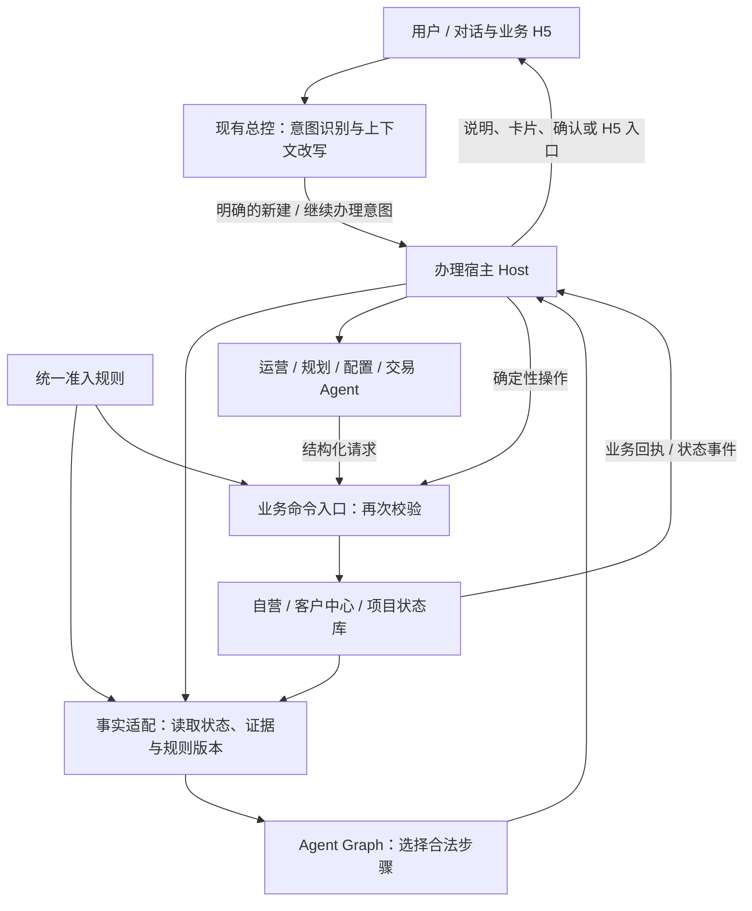
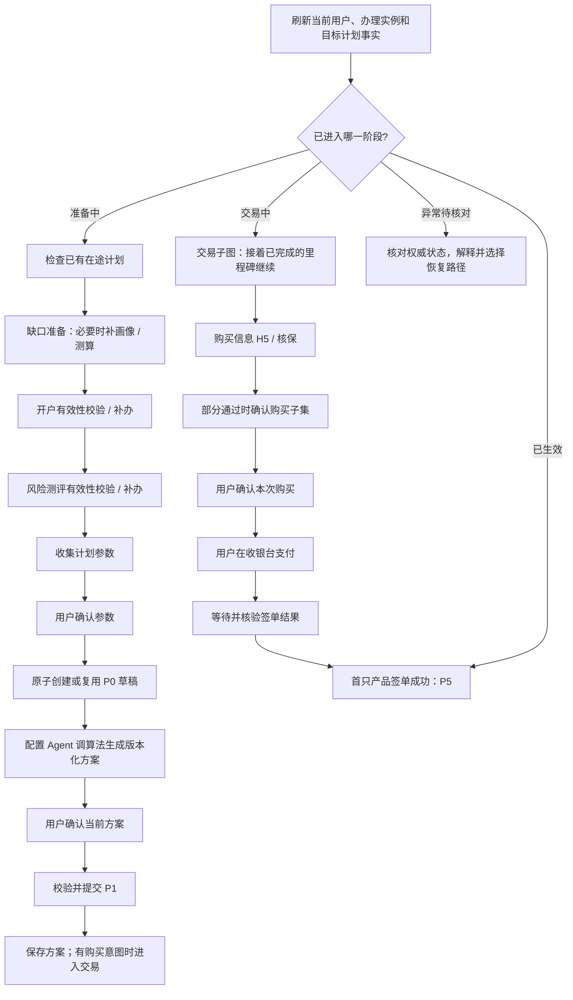

AI 设计建议，供评审。业务依据见[国民养老客户页](../国民养老.md#双状态机诉求)。本目录中的 Provider、Graph 和 Action 是可校验的工作契约；Host Handler 名称和 Facts 字段是本方案拟定，尚未接入实际业务接口。

**11-11 晚更新：**团队当前方向是先识别意图，再进入业务按实时状态判断能否办理。韩康明确双状态机文档不是实际开发依据。本文采用的 P0/P1 触发、P0–P4 单在途、S3/S4/S5 守卫等均为待场景/API 核验的建模假设；Graph、共享规则服务及 Host 的形态也是本方案建议，尚未被客户选定。[最新讨论与来源](../国民养老.md#11-11-晚意图状态与实施依据)

## 目标与范围

从已登录用户表达“新建养老计划”开始，覆盖缺口准备、开户/测评、参数确认、P0 草稿、方案确认、P1，再衔接核保、支付、签单至 P5。

分开看两个交付结果：

- **计划准备完成**：当前版本方案已被用户确认，P1 已落库，可以衔接交易。尚未购买或生效。
- **计划首次生效**：当前计划至少一只产品签单成功，P5 有权威业务回执。未决产品继续跟踪，不随本图结束而丢弃。

S0 游客、注册登录由入口处理。未登录不进入本图。计划变更 P6、计划终止 P7 各自建独立工作图，复用状态服务和准入规则。

## 总体架构



Host 是产品后端的执行与办理适配层，不要求新增一个 LLM 主 Bot。现有 Agent 仍负责其业务域。Graph 给出当前可执行步骤及所需规程，Host 决定调用既有 Agent、接口还是 H5。

影响意图判断的状态可由总控按需读取，状态的更新归属仍按业务权威来源逐项确定。只有用户选择新建或继续办理时才进入对应工作图；查询计划、咨询产品等意图不因开户或测评缺失而强行跳入补齐流程。

| 模块 | 本方案职责 | 建议建设归属，待项目确认 |
| --- | --- | --- |
| 现有总控 | 识别新建、继续、查询、改参数或切换话题；不把所有输入锁进办理流程 | 总控侧 |
| Graph Provider | 稳定工作图、动作契约、规程、原因码、测试与版本 | 平台产研与实施共同维护 |
| Host / 办理服务 | 运行隔离、事实刷新、Route 分发、挂起唤醒、事件记录、版本绑定 | 平台/项目共同确认 |
| 事实与状态服务 | 适配权威业务数据、存储项目办理数据及聚合资格；供所有 Agent 复用 | 客户业务系统 + 项目侧接口，归属待定 |
| 规则服务 | 单份规则定义，统一计算准入与失败原因；读路由、写操作调用相同版本的规则实现 | 项目建设，业务方审核口径 |
| 业务命令入口 | 权限、幂等、原子状态变更、操作回执、实际副作用 | 对应业务服务 |

这些是职责划分，可先在一个后端服务中实现，暂不要求拆成多个独立部署单元。

## 三张工作图

1. `new-plan`：刷新事实，按办理阶段进入准备、交易、核对或已生效出口。
2. `prepare-plan`：准备业务前提，生成并确认方案，提交 P1。
3. `purchase-plan`：衔接购买资料、核保、用户购买确认、支付与签单。

阶段来自已核验的业务里程碑：当前方案尚未确认是 `prepare`；当前 P1 已提交且有交易意图是 `trade`；业务失败、方案需重构等是 `recover`；存在首只签单成功证据是 `effective`。`phase` 不是 Agent 任意填的路由指令。

准备图结束返回 `partial`，表示整条新建旅程尚未生效。Host 刷新 P1 事实后，可在用户继续购买的意图下进入交易图。单纯保存方案时停在 P1，不自动拉起收银台。



图中开户、测评等节点可以被当前有效证据直接满足，不要求用户重走。准备节点之间有推进顺序，用户资格字段本身仍是独立条件。

## 状态如何存放

### 三类状态分开

| 类别 | 示例 | 权威来源 |
| --- | --- | --- |
| 业务事实 | 开户有效、测评有效期、planningID、P0–P5、产品级核保/支付/签单结果 | 对应业务接口和数据库 |
| 办理产物与决定 | caseId、参数版本、方案版本、用户确认记录、交易请求 ID | 办理服务与业务服务 |
| 图运行信息 | 当前 Route、Graph 版本、Outcome、等待原因、事件游标 | Host 的 Run Store |

Run Store 不成为账户或计划状态的第二套事实源。重启时先查业务系统，再恢复当前 Route。查询超时与“未开户”分开表达。

### 多计划与在途约束

- 登录身份由服务端确定；运行键采用 `tenantId + userId + caseId`，P0 创建后绑定 `zqslplanID`。会话 ID 只作为入口引用，不作为办理身份。
- 读取计划、消费事件、记录确认和执行命令，都核对目标计划属于当前用户且与办理实例绑定。
- 发现本办理实例自己的 P0–P4，恢复该计划；发现其他办理实例的在途计划，提示继续已有计划，不自动覆盖或取消。
- 创建 P0 时在业务库原子检查“当前用户只有一个 P0–P4 在途计划”。前置查询只是提示，数据库事务/唯一占用记录才防止两个会话同时创建。
- 已有生效计划 A，不妨碍在规则允许时创建 B。B 的确认和交易不得复用 A 的状态、确认或回执。

## Facts 与证据

下列为拟定的数据模型。金额、证件等敏感字段保留在业务系统，需要时按字段授权读取，不整份送入模型。

```json
{
  "context": {
    "authorized": true,
    "userId": "当前登录用户",
    "caseId": "本次办理实例",
    "planId": "当前目标计划，创建前为空"
  },
  "snapshot": {"ready": true, "revision": "当前业务快照版本"},
  "runtime": {"phase": "prepare"},
  "decision": {
    "createDraftAllowed": true,
    "confirmPlanAllowed": true
  },
  "evidence": {
    "account": {"valid": true, "receipt": "开户状态观测引用"},
    "risk": {"valid": true, "receipt": "测评结果观测引用"},
    "proposal_consent": {"valid": false}
  },
  "plan": {"effective": false}
}
```

`valid` 由可信适配层计算，不接受 Agent、用户消息或任意回调直接写 true。它表示相关证据的主体、目标、版本、有效期及业务结果都满足当前节点要求。

| 证据 | 有效条件 |
| --- | --- |
| 开户与测评 | 权威接口结果；身份一致；来源可用；测评未失效；满足当前操作要求 |
| 参数确认 | 当前用户、caseId、参数摘要/版本完全一致；用户明确确认 |
| 方案 | 当前参数版本、算法版本、适用规则版本匹配；已持久化并可查询 |
| 方案确认 | 当前用户、目标计划、完整方案版本及摘要匹配；没有失效、撤回或被新方案替代 |
| 核保、支付、签单 | 请求 ID、目标计划、产品明细和业务版本匹配；已核验事件来源并查询权威结果 |

Graph 只比较这些可信事实。当前 SDK 的 Fact Check 主要提供 `equals`、`exists`，因此日期比较、产品组合、跨版本匹配和复杂业务条件在统一规则/适配层完成，不能伪造一个 Graph 内置表达式引擎。

## 节点的输入、执行者与完成证据

| 节点 | 执行者 | 输入 / 工作 | 完成证据 |
| --- | --- | --- | --- |
| observe | Host | 校验登录主体和 case，读取最新资格、计划、回执、版本 | 可用且满足时效要求的快照；缺数据则停止派发写操作 |
| check-inflight | Host | 查询本人在途计划，绑定本次办理或引导恢复旧计划 | 当前 case 可以继续的核验结果 |
| prepare-gap-input | 运营/规划 Agent，经 Host 分发 | 只有缺口确需重算时，补齐必要画像并校验数据 | 可复用缺口，或满足缺口计算输入条件的记录 |
| ensure-gap | 规划 Agent + 算法接口 | 复用有效历史缺口，或计算并保存 | 可查询的 planningID 与适用结果版本 |
| ensure-account | 运营 Agent + 自营 H5 | 查询开户；必要时引导开户/再次签约；返回后重查 | 当前账户有效的权威结果 |
| ensure-risk | 运营 Agent + 测评 H5 | 查询适当性；失效则引导重新测评；返回后重查 | 当前有效测评结果 |
| collect-parameters | 配置 Agent | 目标金额、投入、期限等必要参数；按约定算法辅助补参 | 完整且通过业务校验的参数版本 |
| confirm-parameters | 用户 Gate | 展示当前参数，允许返回修改 | 绑定参数版本的确认记录 |
| create-draft | Host / 项目状态 API | 原子校验在途约束、资格及参数确认；创建或复用草稿 | 当前 case 的 zqslplanID、P0 与关联 planningID |
| generate-proposal | 配置 Agent + 算法接口 | 根据已确认参数计算产品组合、现金流、缴费安排和说明 | 可查询的完整 proposalRevision |
| confirm-proposal | 用户 Gate | 展示完整方案、关键限制和版本 | 绑定当前方案的用户确认 |
| commit-plan-confirmation | Host / 项目状态 API | 原子复查资格与确认，将当前方案提交为 P1 | P1 及对应 confirmationId；仅对当前版本成立 |
| purchase-information | 交易 Agent + 自营 H5 | 用户完成购买资料、协议、授权等要求 | 与当前交易版本绑定的办理结果 |
| underwriting | 交易 Host Handler | 幂等提交或查询核保；分清待处理、全过、部分过、全失败 | 至少一只通过且明细可核验；失败走恢复 |
| accept-product-selection | 用户 Gate | 部分通过时确认购买子集/金额，或返回调整方案 | 原方案全通过且范围不变时可复用原确认；子集变化则需新确认 |
| confirm-purchase | 用户 Gate | 在业务页面确认本次产品、金额及购买事项 | 当前交易版本的明确购买确认 |
| payment | 自营收银台，交易 Handler 关联请求 | 用户实际支付；系统查询结果 | 至少一项支付成功且产品明细可核验；未支付不算完成 |
| observe-issuance | Host | 消费/查询签单事件，可跨会话等待 | 当前计划首只产品签单成功，P5 可核验 |
| park / reconcile | Host | 挂起等待，或查询权威状态、解释失败和缺失证据 | 已保存等待信息，或已形成可供后续处理的核对结果；不算业务成功 |

样例 Action 均使用 `runner: host`：由 Host 接既有 Agent、H5 和业务接口，避免假定现有子 Agent 已采用本仓库的 Skill 协议。三个 Resource 文件提供按阶段加载的规程，后续可拆到动作级。

## 用户 Gate 如何落地

参数确认、方案确认、购买范围确认和购买确认均设为 `delegatable: false`。普通会话 authority 不替代业务用户的具体确认。

确认卡片/页面携带服务端签发的一次性 token，绑定当前用户、case、目标计划、产物摘要和版本。点击后，Host 校验 token、当前版本、重复请求和权限，再保存决定。Graph 读取当前确认是否有效，决定能否继续。

用户说“帮我全办了”仍需按业务要求呈现应确认的具体内容。用户在支付 H5 完成交易；Agent 不代用户支付。

参数或方案发生变化：新建修订、明确使依赖的旧方案和确认失效、重新求值。交易请求已发出时，不直接覆盖原交易版本；先核对订单与核保结果，再按业务规则进入调整、重提或独立办理路径。

## Host 执行循环

```text
用户明确办理 / H5 返回 / 业务回调 / 定时唤醒
  → 校验身份、case、事件关联及当前意图
  → 从业务系统刷新 Facts，计算当前有效证据和共享规则裁决
  → evaluate(new-plan, facts, scopedOutcomes)
  → 带 Evaluation Revision 解析 Route
  → Gate：展示当前版本并等待用户
  → Action：分发既有 Agent 或稳定 Host Handler
  → 所有业务写入先经过统一命令入口
  → 保存结果引用，刷新 Facts，再求值
```

- Agent 生成参数、文案、候选方案及工具请求；Host 校验 Schema、目标、规则及权限。Agent 不能直接制造完成证据。
- `requiresFacts` 决定某一步当前是否合法；`satisfiedBy` 用业务证据跳过已完成步骤。Outcome 为 completed 而证据不成立时，进入 unverified / reconcile。
- H5 或异步任务未结束时返回 partial，Host 保存等待原因、请求 ID、业务版本和事件游标后挂起。SDK 不负责持续轮询或队列调度。
- 用户切去问产品知识时，总控处理当前问题，办理保持暂停；不能因为图里有下一步就自动推进业务。
- 恢复时先刷新 Facts；Run 的旧 Outcome 只在相同 case、步骤输入版本和业务操作标识下复用。输入已变更时，Host 明确失效相关 Outcome，重新核验。

## 业务命令与共享规则

Graph 读侧和命令写侧调用同一套规则定义。避免在两个地方分别实现 S3+S4+S5。

拟定命令格式：

```json
{
  "operation": "confirm_plan",
  "caseId": "case-b",
  "targetPlanId": "plan-b",
  "expectedPlanRevision": 3,
  "expectedProposalRevision": 5,
  "confirmationId": "用户对方案第5版的确认",
  "idempotencyKey": "本次语义操作的稳定唯一键"
}
```

用户身份由服务端登录态确定，不相信调用方传来的 userId。命令入口重新查当前资格、产品与规则版本，并执行原子比较与更新。旧版本、无效确认、目标不匹配、第二份在途计划等情况，返回明确原因及可恢复信息。无权或来源不可信时拒绝；接口不可用时保持未知，不执行写入。

样例暂按以下规则建模，正式条件、迁移和例外必须逐项与业务/API 核验后定版：

| 规则 | 约束 |
| --- | --- |
| create-draft | 当前用户可创建；S3/S4/S5 满足；参数确认有效；同用户无其他 P0–P4；目标是本人 case |
| confirm-plan | 当前完整方案与参数版本匹配；资格当前有效；方案确认对该版本有效；目标 P0 可确认 |
| start-underwriting / payment | 当前交易产品、金额、资格、业务授权与确认满足要求；已有同操作先查结果 |
| record-effective | 仅接受核验后的签单结果；产品、计划和请求关联正确；按业务规则聚合为 P5 |

事务边界由业务服务落实。Graph Route Revision 可拦截旧路由，但不能代替账户服务的并发控制。

## 等待、失败和恢复

| 情况 | 处理 |
| --- | --- |
| H5 已打开、用户退出 | 保存等待状态；重新进入后查询办理结果，再决定展示入口或继续 |
| 核保全失败 | 保留失败明细，询问调整方案或结束；不进入支付 |
| 核保部分通过 | 用户确认剩余产品和金额，或修改方案；不能静默删掉失败产品后照旧购买 |
| 请求超时，是否创建订单未知 | 用稳定请求键查原操作；结果未知时继续核对，不用新键再下单 |
| 支付部分成功 | 产品级记录分别保持；成功项跟踪签单，失败项按订单有效性与用户意图处理 |
| 已支付、签单尚未同步 | 保持 P4 / 待签单，等待业务回调或受控查询，不再次发起支付 |
| 首只签单成功，其余未决 | 计划按规则进入 P5；交易跟踪任务继续处理未决项，事件不被图完成吞掉 |
| 两个会话同时新建 | 最终由 create-draft 原子操作决定；失败的一方定位已有在途计划并引导恢复 |
| 资格在确认后失效 | 提交业务前拦截并补齐；已提交交易先核对现有结果，不把既有付款或签单撤销成未发生 |
| 用户改主意 / 切换话题 | 暂停办理；取消已有 P0 或订单遵循单独业务确认流程，不自动删除 |
| Graph 或规则发布新版本 | 新办理使用新版本；在途实例显式判断迁移影响。关键规则变化使受影响确认失效，不能静默重放旧动作 |

订单超时、核保有效期、部分成功后是否重生成 payplanID、计划变更等细则，以业务方确认的规则为准，未直接采信旧文档里相互冲突的描述。

## 规则如何维护

运行中的 Graph 拓扑保持稳定，业务规则走统一版本化定义。面向业务人员的编辑方式先收敛为“条件字段、比较值、组合方式、失败处理方向”，不开放任意脚本。

变更流程：编辑草稿 → 展示与当前版本的差异 → 跑固定业务场景与拒绝场景 → 业务审核 → 发布不可变版本 → 评估在途实例与旧确认 → 记录生效范围。

自然语言或知识编译可帮助生成规则/图草稿，发布前必须经过相同校验。业务不明确的字段、例外、数据源优先级不能由模型自行补成生产规则。规则配置界面、审批、影响分析属于项目建设，不计作 Agent Graph 现成功能。

## 契约样例与验证边界

- 入口：[provider.json](provider.json)。三张图位于 [new-plan.json](graphs/new-plan.json)、[prepare-plan.json](graphs/prepare-plan.json)、[purchase-plan.json](graphs/purchase-plan.json)。
- 示例 Facts：[facts.example.json](facts.example.json)。命令：`sh 验证.sh`，使用固定版本 `@c4a/agent-graph@0.3.1` 执行静态校验与路由用例。
- 样例覆盖准备、确认、交易各步骤，以及旧确认失效、伪报完成、在途冲突、会话 authority 无法替代用户 Gate、支付不等于签单、等待挂起等路由。
- Handler 只有契约声明。路由用例使用虚构 Facts，只证明候选图内部逻辑；不证明业务规则已被客户确认、接口可用、确认 token 安全、事务幂等或性能达标。它们分别需要需求、Host、接口及集成验证。
- 额外必须做的集成验证：A 计划回执不可完成 B；旧方案确认不可批准新方案；重复/乱序回调不可重复操作或倒退状态；并发新建只能成功一个；业务接口超时不可导致重复交易。

首轮验证先跑准备图至 P1，并用假的业务服务替身验证确认和并发边界；接口确定后接交易子图。完成证据、Host 副作用边界和客户规则口径一起评审，不能只验图能走通。

## 待确认

1. 状态聚合库、规则服务、Host 和各接口的实施归属；已有能力可复用多少。
2. 用户主阶段与独立资格的定义；有历史缺口、画像不全时如何处理。
3. 参数字段、校验口径、失效条件，以及 P0/P1 的正式触发定义；P0–P4 单在途及 S3/S4/S5 守卫是否适用于实际接口和全部相关场景。
4. payplanID、订单、核保和产品级支付的关系；交易时效、失败与部分成功的规则。
5. 客户要求的规则配置和审批界面深度，首批验收场景及在途版本迁移要求。

## 依据

- 客户[双状态机需求](https://www.kdocs.cn/l/coVF7puoOnnh)、[高代码 Agent 需求](https://www.kdocs.cn/l/ckYjLZGp1UgN)，业务要点和材料冲突见[客户页](../国民养老.md)。
- [11-05 内部复盘](https://bytedance.larkoffice.com/docx/R67cdsMYhogrlqxRrlRcyVL5nNd)、[11-10 架构候选方案](https://bytedance.larkoffice.com/wiki/U4vywWANniW6A8kRazact3Cjn4c)。
- Agent Graph [编写规范](https://github.com/context4ai/agent-graph/blob/ee93426527b1ce4dbfb750b03ee9b2965198e5ce/docs/zh-CN/authoring.md)、[接入职责](https://github.com/context4ai/agent-graph/blob/ee93426527b1ce4dbfb750b03ee9b2965198e5ce/docs/zh-CN/adoption-paths.md)、[运行与恢复](https://github.com/context4ai/agent-graph/blob/ee93426527b1ce4dbfb750b03ee9b2965198e5ce/docs/zh-CN/runtime-and-recovery.md)。协议样例按 npm 0.3.1；对照源码提交 `ee93426527b1ce4dbfb750b03ee9b2965198e5ce`。
