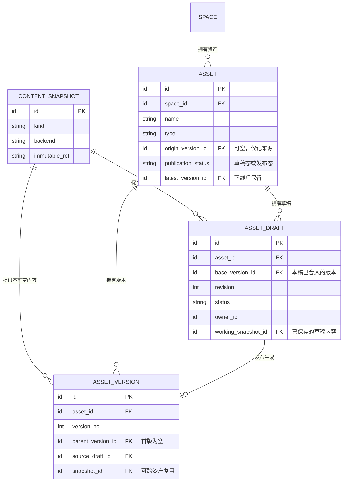

## 当前共识（11-13）

团队确定采用杨宇航当前的空间整体方案，服务编译和上下文，共用部分由空间承担，业务特有设计由各模块负责。编译侧统一使用 asset 语义继承原 artifact 能力，资产有状态机和版本；同步梳理前端接口与产品动线。

车政行15:57发出会议结论，费夕杨18:19与熊磊对齐后确认，车政行再次认可。产品交互与易用性继续梳理；现有记录尚未逐条明确历史恢复、重发和删除的最终行为，原验收用例继续用于核对。下方11-12候选模型与AI建议保留为讨论历史，不替代本次团队方案。

来源：[会议结论](https://applink.feishu.cn/client/chat/open?openChatId=oc_9865f5013ddc915fe16ece8615518e2c&position=12)、[产品确认](https://applink.feishu.cn/client/chat/open?openChatId=oc_9865f5013ddc915fe16ece8615518e2c&position=13)。

## 产品诉求

11-12 我明确两条要求：资产支持版本管理；草稿台的内容对外不可消费，发布后的版本可供外部消费。首次发布前没有可消费的版本。已有 v1 时，保存新草稿不影响外部读取 v1；新草稿发布为 v2 后，按当前版本读取才会拿到 v2。

已发布的资产可以下线。下线后资产回到草稿态，对外停止消费，原发布版本保留在历史中。重新发布时生成下一个版本，即使内容没有修改。

同一资产可以同时有多份待发布的新版本草稿。各份草稿独立编辑、保存，都对外不可消费。发布其中一份只让该份内容生效，其余草稿仍可继续编辑。

旧草稿发布时，如果它的基线之后已有新版本发布，系统提示冲突，中止本次发布。冲突解决后才能发布为下一版。

## 产品验收用例

以下用例均针对同一份资产。外部读取指下游发起新的消费请求。

11-12我已把八条主线用例同步给产品和架构同学，并补问历史回滚、下线恢复、发布态删除等语义。用例是我推动对齐的验收依据，技术模型尚未定案。

| 用例 | 操作 | 管理台预期 | 外部读取预期 |
| --- | --- | --- | --- |
| 1. 首次发布前 | 新建资产，保存草稿 A。 | A 可编辑、预览，尚无正式版本。 | 无可消费版本；指定 A 也读不到草稿。 |
| 2. 首次发布 | 发布 A。 | 生成 v1，资产进入发布态。 | 读到 v1。 |
| 3. 并行起草 | 从 v1 分别开草稿 B、C，各自修改并保存。 | B、C 同时存在，保存一份不影响另一份。 | 仍读到 v1，B、C 均不可消费。 |
| 4. 选择一份发布 | 先发布 C。 | C 的内容成为 v2；B 保留原有修改，仍基于 v1。 | 按当前版本读到 v2。 |
| 5. 旧草稿尝试发布 | 在 v2 已发布后，直接发布 B。 | 提示基线冲突，保留 B，不生成 v3。 | 继续读到 v2。 |
| 6. 解决冲突后发布 | 对照 v2 解决 B 的冲突，确认最终内容并发布。 | 生成 v3，内容与用户确认的一致。 | 按当前版本读到 v3。 |
| 7. 下线 | 将已发布的 v3 下线。 | 资产回到草稿态，维护者仍可查看版本历史。 | 停止消费；指定原版本号也不可读取。 |
| 8. 下线后重新发布 | 分别验证原样重发、修改后重发，两种情况都从 v3 下线后开始。 | 两种情况均生成 v4。原样重发时内容与 v3 相同，修改后重发时包含本次修改。 | 发布成功前不可消费，成功后按当前版本读到 v4。 |

### 待产品确认：下线时已有其他草稿

从用例 4 分支：10:00，C 发布成 v2；10:05，B 又保存一次，仍基于 v1；10:10，v2 下线。此时外部停止消费。我的倾向是“以最后一个变更的版本作为基线”，具体口径待确认：

- 下线后点“继续编辑”，默认打开最近保存的 B，还是基于刚下线的 v2 另开草稿并保留 B？
- “最后一个变更”是否包含未发布的草稿修订？如果继续编辑 B，它原有的 v1 基线与 v2 之间的差异仍需在发布前解决。

## 设计讨论

11-12 我提出资产管理要支持草稿、发布和版本管理。并发修改优先支持多人从同一资产各开一份草稿，各自保存、预览，自己决定何时发布。资产有文件系统和图谱两类形态。我明确空间作为资产管理中不同用途的边界，先按一份资产只归属一个空间设计。不同空间的资产在业务上各自独立，底层可以复用同一份物理内容。

相关场景见 [Agent Infra](需求/S21/Agent%20Infra.md) 中的任务工作副本与待审产物。

### 11-12 空间是否管理未发布草稿

群里把分歧收敛到草稿归属，尚未定案。知识编译需要保留多份候选稿，用户启动编译时可以只说“从文档建本体”，到审阅产物时再决定新建还是更新已有资产。[验收用例与模型附件](https://applink.feishu.cn/client/chat/open?openChatId=oc_c16c381fa15023469dc670bda342f96c&position=46) · [产品动线讨论](https://applink.feishu.cn/client/chat/open?openChatId=oc_c16c381fa15023469dc670bda342f96c&position=52) · [草稿归属分歧](https://applink.feishu.cn/client/chat/open?openChatId=oc_c16c381fa15023469dc670bda342f96c&position=59)

杨宇航的空间方案 v2 将任务候选产物留在编译域，另在 Asset 上保留一个可选草稿指针。这个指针能登记首发前的一份内容；已有 v1 时，B、C 两份稿各自的内容、修订和基线仍需另有归属。[VeKnow 空间基建技术方案](https://bytedance.sg.larkoffice.com/docx/UzCOd85X6oVnscxNmy9lskQQgwg#doxlgfYJy3PheW87Z15nCPlgzxc)

AI评估建议：本期由编译侧保存和审阅候选稿。更新已有资产时保留实际起稿基线，发布时由空间校验基线、登记不可变版本、切换对外读取。若出现从空间资产列表继续编辑未发布稿，或另一个应用接手同一稿的需求，再评估空间级独立草稿。上下文 PRD 已写明 Wiki 图谱取已发布 Wiki，尚未看到跨应用续编草稿的用例。[上下文产品 PRD](https://bytedance.larkoffice.com/wiki/CaOlwLqXYiigbOkerDdcoT3anwf)

恢复和重发还要跟产品确认。上面的用例 8 按“原样重发也生成 v4”验收；空间 v2 另提供恢复 v3 的动作，也允许在下线期间直接发布 v4。产品是否展示两个入口、已发布资产是否允许删除，群内仍在讨论。[待产品确认的用例](https://applink.feishu.cn/client/chat/open?openChatId=oc_c16c381fa15023469dc670bda342f96c&position=47)

22:08杨宇航把未定问题归为两项：**空间是否管理草稿，以及历史恢复时沿用旧版本号还是每次递增版本**。熊磊安排11-13下午拉产品和国凯决策，我提出也请李彬参加；会议安排尚未成为方案结论。[两项分歧](https://applink.feishu.cn/client/chat/open?openChatId=oc_c16c381fa15023469dc670bda342f96c&position=62)、[决策安排](https://applink.feishu.cn/client/chat/open?openChatId=oc_c16c381fa15023469dc670bda342f96c&position=60)。

**我的判断**：两套模型都能实现，选择应看长期产品诉求和维护成本。先从业务用例出发，再判断模型；无论选哪套，都要和产品对齐概念，避免产品与技术对草稿、资产、版本的理解不同。[我的判断](https://applink.feishu.cn/client/chat/open?openChatId=oc_c16c381fa15023469dc670bda342f96c&position=53)、[概念对齐要求](https://applink.feishu.cn/client/chat/open?openChatId=oc_c16c381fa15023469dc670bda342f96c&position=56)。

材料来源：11-12 Codex《梳理资产管理系统核心诉求》（local，ID `01a1cfab-55da-7a52-bf92-cda14d753c0e`）与《梳理资产管理模块设计》（local，ID `01a1cec8-9a9c-7482-9966-48ed603adb75`），以及[我向团队同步的用例和候选模型](https://applink.feishu.cn/client/chat/open?openChatId=oc_c16c381fa15023469dc670bda342f96c&position=46)。候选ER和架构评估尚未作为实施方案。

## 空间与资产归属

空间按业务用途组织，可同时包含文件和图谱。相关背景见 [本体建设中的用途型空间](本体建设.md#11-06：用途型空间与场景编译)。每份资产只归属一个空间，草稿和版本经资产继承归属。空间提供业务上下文，资产仍各自发布、下线，无需整空间加锁。

创建、列举资产时指定空间，读取或修改资产时校验它与当前空间的关系，再解析文件或图快照。若空间由公共底座维护，资产侧直接引用已有空间 ID。

候选实现：B 从 A 的一个正式版本起稿，创建 B 自己的资产和首稿，首稿基线为空，初始内容取自 A 的只读快照。B 原样发布时，A 的 v3 和 B 的 v1 可以引用同一快照 S1。B 修改并发布后，B 的 v2 指向 S2。两边各自决定发布、权限和下线。可用 B 的 `asset.origin_version_id` 记录来源 A v3，仅用于追溯。只要任一保留版本或草稿还引用 S1，就要保留这份快照。

### 两种模型的发布边界

评估判断：业务管草稿时，编译侧对“用户确认了哪份稿、哪次修订”负责。发布时交给空间的是已固定的内容引用、目标资产（或新建意图）和实际起稿基线。空间校验基线后登记正式版本。若空间已发布、编译侧还没收到回执，编译侧需要凭同一发布请求查回结果。

空间管草稿时，每份草稿在空间有独立身份。发布时提交草稿 ID 和确认过的修订，空间可一起校验草稿修订与资产基线、登记版本、关闭该稿。这要求所有编辑入口共用草稿权限、保存和发布规则。何时绑定目标资产可以单独设计，两种模型都能支持先生成产物、后选发布目标。

11-13 架构评估：若编译侧只保存任务候选产物，方案一有两类实体。更新已有资产时，候选产物引用空间的资产 ID 和起稿版本；发布成功后回记正式版本 ID，当前生效版本由空间维护。若产品要求同一资产从首稿起就可独立于任务被找到、管理多稿和查发布历史，建议采用空间统一的资产、草稿、版本模型。编译侧保留运行和产物来源，通过 ID 关联，避免两端各维护一份资产生命周期。

### 11-16 逻辑边界与运行环境

我沿方案二继续评估模块边界，明确要把逻辑与物理两个维度分开：权限、资产归属是逻辑视角；我理解空间也可以是一套预装环境或初始化内容，沙箱承载实际运行。沙箱不必绑定Agent，直接执行脚本、CLI或编译器也成立。

AI架构建议：逻辑上划分工作空间、资产管理和知识编译；运行层分别封装沙箱执行与可选Agent Runtime。编译任务与Agent运行分开维护身份、状态：同一任务可直接执行命令，也可经历多次Agent尝试；Agent正常结束但业务校验失败时，编译任务仍未完成。服务如何拆分、空间持久化和两种执行路径的接口尚待评审。

团队实施方向仍以11-13确认的公共空间方案为准；本轮的模块拆分和草稿、版本具体模型待评审。

来源：11-16 Codex《评价群聊与相关文档》（local，`01a1d00d-d2ed-7451-b885-96d054df0a5d`），用户对非Agent执行的说明 `01a1e374-1f91-7192-b49a-45fc7c0a4581`、预装环境理解 `01a1e3ae-c1e1-7510-9765-1037110b14cb`、逻辑与物理区分 `01a1e3af-54ac-7900-a7d3-7a47119a8900`；任务与Agent分离为后续问答中的架构建议（`01a1e3b0-8e18-7280-948f-6bffe02a918f`）。

## 候选数据模型

### 11-16 外部模型对照

**GitHub 源码对照。** 固定发行版核对模型和发布方法，以下是架构借鉴。

- **Directus v11.17.4** 最接近并行草稿。同一条目可按不同 key 建候选，每份保存起稿时主内容的 hash 和自己的 delta。比较接口用已存 hash 判过期；提升接口校验调用方传的 mainHash，再把选定修改写回主条目。我们要拦住所有旧基线发布，应由服务端读取草稿的 base_version_id，并在同一次提交中有条件地推进当前版本。[版本字段](https://github.com/directus/directus/blob/1f9a051041029e59b17a1a36249f232e59e60e9b/packages/system-data/src/fields/versions.yaml) · [比较接口](https://github.com/directus/directus/blob/1f9a051041029e59b17a1a36249f232e59e60e9b/api/src/controllers/versions.ts#L212-L219) · [提升实现](https://github.com/directus/directus/blob/1f9a051041029e59b17a1a36249f232e59e60e9b/api/src/services/versions.ts#L305-L365)
- **Wagtail v7.4.4** 分别维护最近编辑修订、线上修订和是否有未发布修改。发布方法可以选定较早修订，并保留存在更新修改的标志。适合借鉴读模型；旧稿是否允许发布仍是产品规则。[修订实体](https://github.com/wagtail/wagtail/blob/4c945d6584abe3553c724e925179a7aa65536922/wagtail/models/revisions.py#L96-L113) · [发布实现](https://github.com/wagtail/wagtail/blob/4c945d6584abe3553c724e925179a7aa65536922/wagtail/actions/publish_revision.py#L128-L145)
- **Apache Iceberg 1.12.0** 的 fastForward 在更新分支引用前校验祖先关系，历史分叉会拒绝。B、C 同出 v1 而 C 已发布时，可类比这条规则。单资产顺序发布用基线等值校验即可。[快进校验](https://github.com/apache/iceberg/blob/212aa894e919ff9fdf89160da4aadcbe6858ac01/core/src/main/java/org/apache/iceberg/UpdateSnapshotReferencesOperation.java#L113-L146)
- **MLflow v3.18.0** 的 ModelVersion 保存来源和 run_id，别名单独指向一个注册版本。编译的运行信息可用 ID 追溯，共用资产服务维护正式版本。[版本字段](https://github.com/mlflow/mlflow/blob/ba41106d110b67096384da12b6b85473457598db/mlflow/store/model_registry/dbmodels/models.py#L97-L129) · [别名模型](https://github.com/mlflow/mlflow/blob/ba41106d110b67096384da12b6b85473457598db/mlflow/store/model_registry/dbmodels/models.py#L249-L267)
- **Pimcore v12.3.12** 给版本记录分配独立 ID，文件内容按哈希查找可复用的二进制 ID。原样重发如果要生成新版本，可复用旧内容；产品版本号与文件哈希承担不同职责。[版本保存](https://github.com/pimcore/pimcore/blob/16486afce81acd97a5542fe2ff286e8a22d382c6/models/Version.php#L142-L183)

| 系统 | 公开模型与可借鉴点 |
| --- | --- |
| Adobe AEM Assets | 一个 Asset 可保存多份 Revision，按修订 ID 恢复。保存版本和发布是独立动作。文件、派生文件和元数据都可能属于同一版本，知识编译也要明确一次发布固定哪些内容。[AssetManager API](https://experienceleague.adobe.com/en/tools/aem-api-documentation/cloud-service/javadoc/com/day/cq/dam/api/AssetManager.html) · [版本范围](https://experienceleague.adobe.com/en/docs/experience-manager-learn/assets/collaboration/versions) · [发布管理](https://experienceleague.adobe.com/en/docs/experience-manager-cloud-service/content/assets/manage/manage-digital-assets) |
| Contentful | 同一资产可以处于 Changed，表示已发布且有待发布修改。管理和预览 API 可读修改，交付 API 继续读最近一次发布。资源修订、已发布修订、发布次数各有字段。适合借鉴读接口和页面状态。[状态判定](https://www.contentful.com/developers/docs/tutorials/general/determine-entry-asset-state/) · [管理 API 字段](https://www.contentful.com/developers/docs/references/content-management-api/overview/) |
| Sanity | 每篇文档最多一份普通草稿，但可在不同 release 各留一份独立候选。单文档发布可传候选修订和已发布修订，预期值不符时返回冲突。适合借鉴独立稿身份和双重校验。其 release version 是发布前可编辑的内容。[草稿与版本](https://www.sanity.io/docs/content-lake/drafts-and-versions) · [Actions API](https://www.sanity.io/docs/http-reference/actions) |
| Apache Iceberg | 分支引用快照，快照记录父快照。在审核分支写入并验证后，可把 main 快进；两条历史已分叉时快进失败。知识编译可用每份稿的基线和当前正式版本做更简单的等值校验。[快照规范](https://iceberg.apache.org/spec/) · [审核分支](https://iceberg.apache.org/docs/latest/branching/) · [快进条件](https://go.iceberg.apache.org/cli.html#branch-fast-forward) |
| MLflow Model Registry | 模型版本可追溯到来源运行，注册模型的别名指向指定版本。适合借鉴编译任务到资产版本的来源关系，以及按当前版本、指定版本两种读取方式。[注册表工作流](https://mlflow.org/docs/latest/ml/model-registry/workflow) · [注册表实现](https://github.com/mlflow/mlflow/blob/master/mlflow/store/model_registry/sqlalchemy_store.py) |

AI 评估：在 11-13 已确定的共用空间方案下，编译侧保留任务、工作副本和内容生成，进入资产管理的稿件由空间分配独立草稿 ID。发布时校验“审阅的修订仍是这一修订”和“起稿基线仍是当前正式版本”，两项均通过才登记正式版本并切换读取。若下线后允许恢复，保留最近发布版本，单独控制对外可读性。恢复旧版号还是生成新版本，仍按产品动作定义。下方为此前的候选设计。

先按单资产独立发布设计。一个资产可以有多份草稿和多个正式版本，同一时刻至多一个版本被选为当前版本。

| 实体 | 主要字段 | 含义 |
| --- | --- | --- |
| `space` | `id`、名称、用途 | 逻辑空间，可复用空间底座已有实体。 |
| `asset` | `id`、`space_id`、`name`、`type`、`origin_version_id`、`latest_version_id`、`publication_status` | 稳定的资产标识。最近发布版本在首次发布前为空，下线时保留。发布状态取草稿态或发布态。 |
| `content_snapshot` | `id`、`kind`、`backend`、`immutable_ref` | 定位已固定的内容，例如文件树清单、图修订或组合清单。复用时直接引用已有 ID。 |
| `asset_draft` | `id`、`asset_id`、`owner_id`、`base_version_id`、`revision`、`working_snapshot_id`、`status` | 一份草稿对应一次变更。基线指向这份内容已合入的最近正式版本。状态可取编辑中、已发布、已放弃。 |
| `asset_version` | `id`、`asset_id`、`version_no`、`parent_version_id`、`source_draft_id`、`snapshot_id`、`published_by`、`published_at`、`change_note` | 本资产的一次成功发布，引用不可变内容并记录它接在哪个历史版本之后，以及由哪份草稿发布。 |

资产的最近发布版本、草稿的基线、版本的父版本和来源草稿都须属于同一资产。来源血缘允许跨资产。权限按逻辑资产校验，再解析快照。草稿每次保存都固定本次内容，多个草稿和正式版本可指向同一快照；发布若需编译，可让正式版本指向包含输入和产物的组合清单。`(asset_id, version_no)` 唯一，`source_draft_id` 唯一；同一个人可以为同一资产开多份草稿。随内容版本发布或恢复的字段放进草稿和版本快照。

保存只更新指定草稿，要求状态为编辑中、修订号与用户读取时相同，成功后修订号加一。发布在同一事务中确认草稿仍是用户预览的修订、基线仍等于最近发布版本，再登记已就绪的快照引用、更新最近发布版本并将资产置为发布态、关闭该草稿。首次发布时基线和最近发布版本均为空。重复发布同一份已发布草稿可按来源找到原版本。

例：A、B 都从 v3 起草。A 发布为 v4 后，B 的基线仍是 v3。系统用 v3、v4 和 B 的草稿做三方比较。用户确认合并后，同时保存 B 的合并内容、把基线更新为 v4、修订号加一。B 发布成功后，v5 的父版本是 v4，来源是 B。哪些资产支持自动合并，待按内容结构确定。

## 领域边界与动作（候选）

按单资产独立生效，资产管理可以作为一个限界上下文，负责从起草到发布、读取和历史恢复的生命周期。建议用 Asset 做聚合根，Draft 是可编辑的子实体，Version 是带独立标识的不可变子实体。通过资产执行命令，保存只定位目标草稿，发布只协调目标草稿和最近发布版本，无需加载全部历史。DDD 术语参考 [Eric Evans《DDD Reference》](https://www.domainlanguage.com/ddd/reference/)。

| 写动作 | 业务结果 |
| --- | --- |
| CreateAssetFromVersion | 从有权复用的来源版本取得内容快照，在目标空间创建独立资产和首稿，后续按目标资产发布。 |
| CreateAsset | 在指定空间建立资产标识并创建首稿，基线为空。 |
| OpenDraft | 从最近发布版本开独立草稿，分配草稿 ID。 |
| SaveDraft | 凭预期修订号保存编辑中的草稿，写入后返回新修订号。 |
| RebaseDraft | 用共同基线、最近发布版本和草稿比较差异。用户确认后，校验草稿修订号及目标版本，一起写入合并内容、新基线和新修订号。 |
| DiscardDraft | 将编辑中的草稿置为已放弃，关闭编辑入口。 |
| PublishDraft | 校验内容、修订号和基线，原子生成版本、更新最近发布版本并将资产置为发布态、关闭并保留来源草稿。重试返回原版本。 |
| UnpublishAsset | 核对待下线版本，将资产置为草稿态并停止对外消费。下线后的起草方式和基线选择待确认。 |
| RestoreVersion | 以最近发布版本为基线，用选定历史快照填充新稿，复用预览和发布流程生成新版本。 |

读能力包括资产与草稿列表、指定修订的草稿预览与校验、最近发布版本、指定历史版本、版本历史，以及版本差异和草稿三方比较。草稿只存最新内容时，预览请求携带的修订号若已过期，应提示刷新。

边界约定：资产类型提供内容校验和合并规则。若发布依赖编译，编译侧返回对应输入的产物，资产侧确认产物可用后让版本生效。资产处于发布态时，消费方按资产 ID 取当前版本，或按资产 ID 和版本号固定读取。若多个资产必须一起生效，需要给整批变更定义发布边界。

### 下线与运行健康

下线后，消费接口按资产 ID 或指定版本号读取都应拦截。维护者仍可查看历史版本、编辑草稿。例：v1 下线后原样重新发布，生成 v2，可复用 v1 的内容快照。

若“不可用”指文件快照读失败或图服务超时，记录故障对应的版本、后端与探测时间。运行健康由探测或读取结果决定，与发布状态分别维护。

## 文件系统与图谱（候选）

版本化范围按用户发布什么来定。目录可作为一份资产，目录内的文件一起生效。图谱先区分本体 Schema、实例数据，以及由源文件编译出的查询产物。若 Schema 和实时实例数据各自演进，Schema 回滚只恢复定义。若源文件和派生图必须配套生效，一份版本清单同时固定源文件树和图快照。

| 操作 | 文件或目录 | 可独立编辑的图谱 |
| --- | --- | --- |
| 开稿与保存 | 从基线文件树开工作副本。保存时固定本次文件树，文件内容可按哈希复用。 | 从基线图快照开稿，草稿可只保存节点、边和属性的增删改，预览时叠加到基线上。 |
| 差异与校验 | 按路径比较新增、删除、修改。文本可按内容合并，同一二进制文件的不同修改由人选择。 | 按稳定节点 ID、边 ID 和属性比较。删除节点与另一稿新增指向它的边存在冲突。合并后检查引用和图约束。 |
| 发布与历史读取 | 版本引用只读文件清单，清单中每个路径指向固定内容。 | 版本引用可重读的图快照，或受保留策略保护、支持按修订查询的图数据。 |

保存外部内容时，先写入隔离的候选修订，再凭预期修订号更新草稿引用。发布先固定待发布修订，在文件或图后端准备并验证只读快照，再用资产库事务校验基线与草稿修订、登记快照引用、切换当前版本、关闭草稿。失败可重试，未被引用的候选产物可回收。读取当前或历史版本都从版本记录解析快照。
